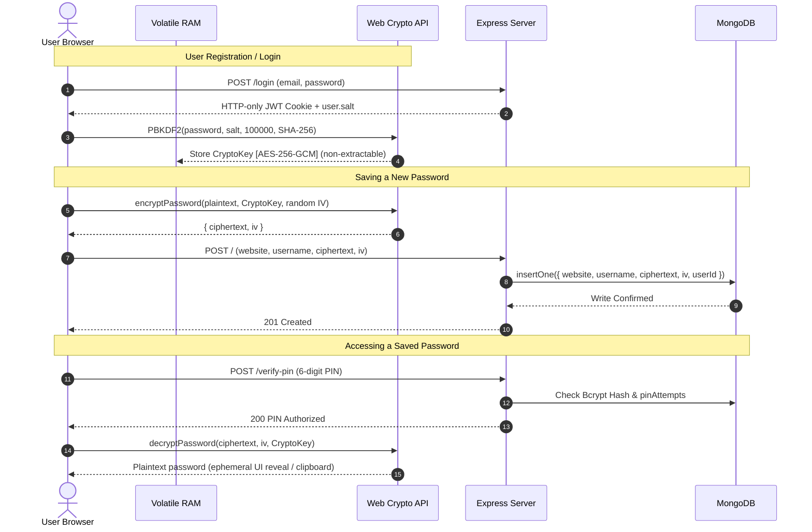

<div align="center">

# 🛡️ SENTRA

### Zero-Knowledge, Client-Side Encrypted Password Manager

[](https://react.dev/)
[](https://nodejs.org/)
[](https://www.mongodb.com/)
[](https://developer.mozilla.org/en-US/docs/Web/API/Web_Crypto_API)
[](https://tailwindcss.com/)

<p align="center">
  <b>Sentra</b> is an end-to-end, zero-knowledge credential vault built with the MERN stack. Designed around the fundamental principle of zero-trust architecture, sensitive passwords are cryptographically sealed inside the browser before ever touching the network.
</p>

[Key Features](#-key-features) • [Security Architecture](#-security-architecture) • [Cryptographic Design](#-cryptographic-specifications) • [Threat Model](#-threat-model--attack-surface-analysis) • [Installation](#-quickstart--local-setup)

---

</div>

## 📌 Executive Summary

Most web applications delegate password encryption to centralized backend servers. Under this legacy paradigm, a compromised server, rogue database administrator, or SQL/NoSQL injection vulnerability can result in the catastrophic exposure of user credentials in plaintext or reversible forms.

**Sentra inverts this trust model.** 

Using native **Web Crypto API primitives** (`window.crypto.subtle`), Sentra ensures that:
- **Plaintext passwords never cross the wire.**
- **MongoDB exclusively stores AES-256-GCM ciphertext and random 96-bit initialization vectors (IVs).**
- **The server is a blind storage provider with zero mathematical capability to decrypt user vault items.**
- **Sensitive actions are guarded by second-factor PIN verification with automated rate-limiting.**

---

## ⚡ Key Features

| Capability | Engineering Implementation | Benefit |
| :--- | :--- | :--- |
| **Zero-Knowledge Encryption** | Client-side AES-256-GCM authenticated cipher | Data is scrambled before transmission; backend breaches reveal only random ciphertext |
| **PBKDF2 Key Derivation** | 100,000 SHA-256 iterations with 128-bit salt | Protects against GPU-accelerated brute-force and precomputed Rainbow Table attacks |
| **Vault PIN Gate** | Secondary 6-digit PIN hashed with Bcrypt | Decouples read/copy actions from raw session tokens with a 3-attempt lockout |
| **Volatile RAM Storage** | In-memory key state (`CryptoKey` non-extractable) | Keys vanish on tab close; immune to `localStorage` XSS credential theft |
| **Session Unlock Modal** | Automatic key re-derivation from stored user salt | Refreshing the page doesn't terminate user sessions or compromise security |
| **Interactive 6-Box PIN** | Reusable `PinInput` component with auto-submit | Keyboard-driven, paste-supported, polished modern user experience |
| **Smart Password Generator** | High-entropy crypto-random string generation | Create 16-character complex passwords directly inside the creation view |

---

##  Security Architecture

The diagram below illustrates the exact cryptographic boundaries separating the client browser from the database:



---

## Cryptographic Specifications

```
                       User Master Password
                               │
                +──────────────┴──────────────+
                │                             │
                ▼                             ▼
       Bcrypt Hashing                PBKDF2 Key Derivation
      (10 Salt Rounds)              (100,000 SHA-256 Rounds)
                │                             │
                ▼                             ▼
       Authentication Token           AES-256-GCM Master Key
       (Server Session Gate)        (Client-Side Vault Decryption)
```

### 1. Key Derivation (`deriveKey`)
* **Primitive:** Password-Based Key Derivation Function 2 (PBKDF2).
* **Hash Digest:** SHA-256.
* **Work Factor:** `100,000` iterations (adheres strictly to current OWASP client-side recommendations, balancing brute-force hardness with ~50ms browser execution).
* **Salt:** 16 cryptographically secure random bytes (`crypto.randomBytes(16)`), base64 encoded and persisted alongside the user record.
* **Key Configuration:** `length: 256`, `extractable: false`, usages: `['encrypt', 'decrypt']`.

### 2. Payload Encryption (`encryptPassword`)
* **Cipher:** Advanced Encryption Standard in Galois/Counter Mode (AES-256-GCM).
* **Initialization Vector (IV):** 12 bytes (96 bits) randomly generated via `window.crypto.getRandomValues(new Uint8Array(12))` for **every single encryption call**.
* **Authentication Tag:** Embedded automatically in GCM ciphertext buffer. Prevents bit-flipping attacks; if ciphertext is tampered with in MongoDB, decryption throws a cryptographic authentication error.

### 3. Password Verification & Decryption (`decryptPassword`)
* The client sends its 6-digit PIN to `/verify-pin`.
* Upon backend verification, the client reconstructs byte buffers from Base64 ciphertext and IV.
* `window.crypto.subtle.decrypt` unlocks the raw bytes into plaintext via native `TextDecoder`.

---

##  Threat Model & Attack Surface Analysis

| Threat Scenario | Vector | Sentra Mitigation Strategy |
| :--- | :--- | :--- |
| **Database Breach / SQLi / Dump** | Attacker accesses raw MongoDB documents | **Mitigated:** Database contains only Base64 ciphertext and IVs. Without the user's master password, data cannot be reversed. |
| **XSS Token Theft** | Malicious script injected via extension or dependency | **Mitigated:** Auth tokens are stored in `HttpOnly, SameSite=None, Secure` cookies inaccessible to JavaScript `document.cookie`. |
| **Client Memory Extraction** | Browser inspection or memory scrape | **Mitigated:** AES key is instantiated as a native browser `CryptoKey` with `extractable: false`, preventing serialization or `console` inspection. |
| **PIN Brute-Forcing** | Automated bot attempts 1,000,000 6-digit combinations | **Mitigated:** Express backend tracks failed attempts in MongoDB; 3 consecutive failures trigger a hard 2-minute lockout. |
| **Rainbow Table Attack** | Precomputed hashes of popular dictionary words | **Mitigated:** Every user account receives a unique 128-bit cryptographic salt generated via CSPRNG. |

---

##  Repository Structure

```text
passop/
├── backend/
│   ├── middleware/
│   │   └── auth.js             # JWT bearer verification via HTTP-only cookies
│   ├── server.js               # Express API: Auth, Bcrypt PIN verification & CRUD
│   └── package.json
│
├── src/
│   ├── components/
│   │   ├── landing.jsx         # Hero showcase with realistic mock vault preview
│   │   ├── login.jsx           # Master sign-in & key derivation orchestration
│   │   ├── register.jsx        # User registration with visual 6-box PIN setup
│   │   ├── manager.jsx         # Password entry form with integrated generator
│   │   ├── vault.jsx           # Vault grid, on-demand decryption & edit modal
│   │   ├── unlockmodal.jsx     # Session unlock modal for memory key recovery
│   │   ├── pininput.jsx        # Reusable keyboard-accessible 6-box PIN component
│   │   ├── navbar.jsx          # Glassmorphic navbar with active route badges
│   │   └── protectedroutes.jsx # React Router route guard for authorized users
│   ├── utils/
│   │   └── crypto.js           # Native Web Crypto engine (PBKDF2 & AES-256-GCM)
│   ├── App.jsx                 # Router root, session watchdog & modal triggers
│   └── main.jsx
├── README.md
└── package.json
```

---

##  Quickstart & Local Setup

### 1. Clone the Repository
```bash
git clone https://github.com/arabdealer/passop.git
cd passop
```

### 2. Configure Backend Server
Navigate to `passop/backend` and create `.env`:
```env
PORT=3000
MONGO_URI=mongodb+srv://<username>:<password>@cluster.mongodb.net/passop
JWT_SECRET=your_jwt_signing_secret_here
```

Install packages and start the API:
```bash
cd backend
npm install
node server.js
```

### 3. Configure Frontend Client
In the root `passop/` directory, create `.env`:
```env
VITE_API_URL=http://localhost:3000
```

Install packages and start the Vite dev server:
```bash
npm install
npm run dev
```

Visit **`http://localhost:5173`** in your browser.

---

##  Author

**Talha Sayed**
- GitHub: [@arabdealer](https://github.com/arabdealer)
- Project: Sentra Zero-Knowledge Password Vault

---

<div align="center">
  <sub>Built with security, privacy, and zero-compromise encryption in mind.</sub>
</div>
